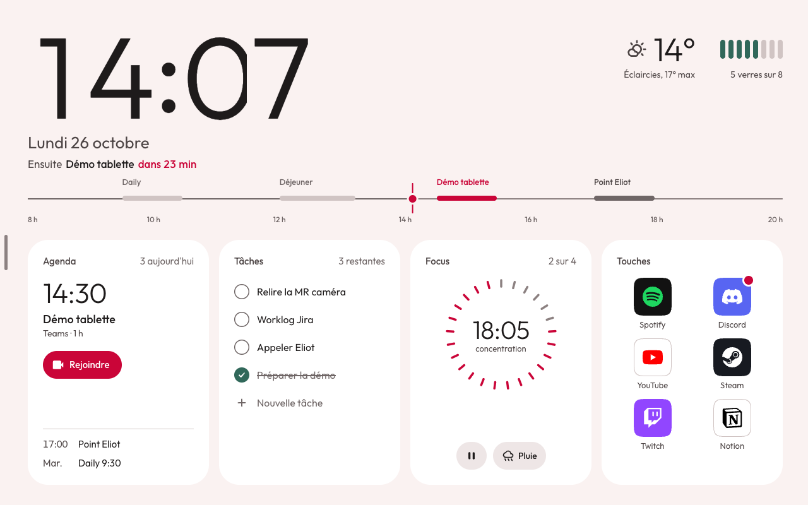
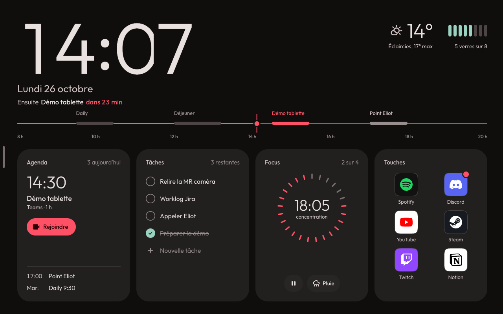
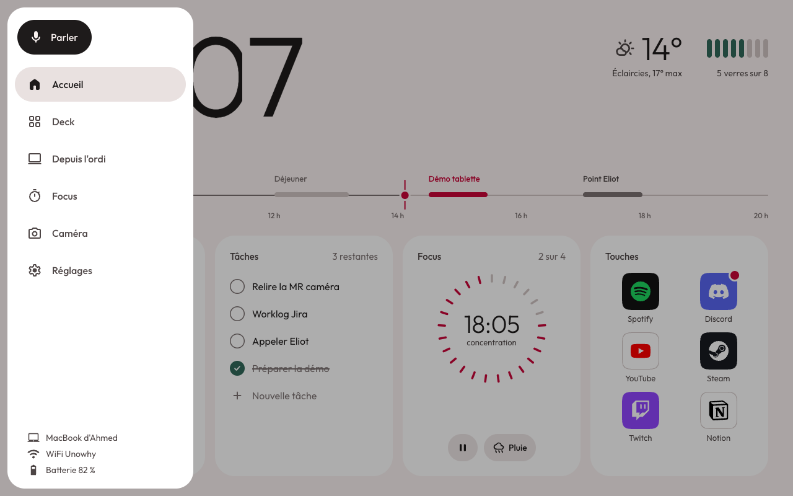
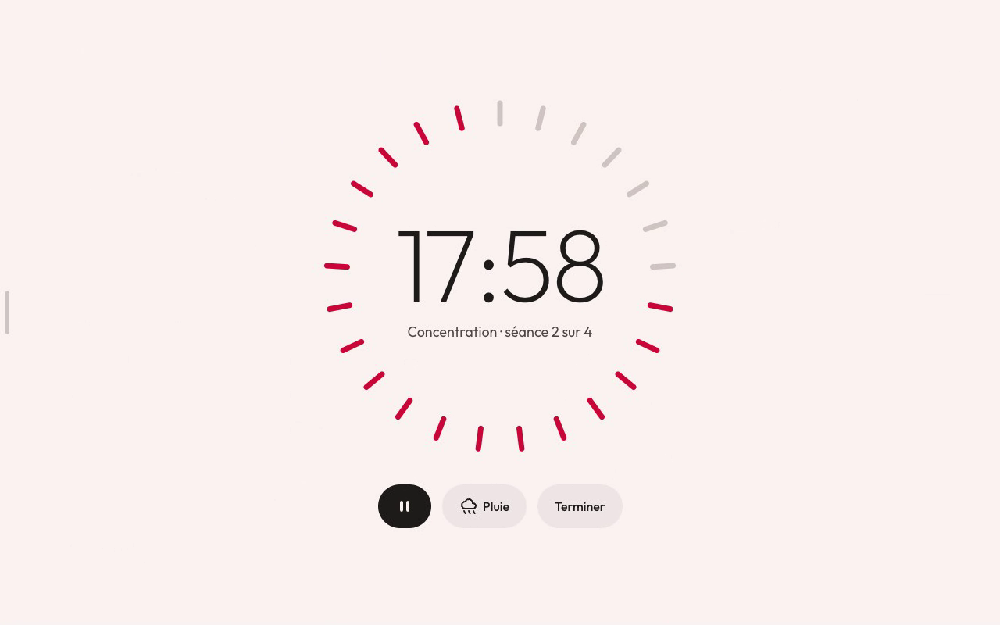
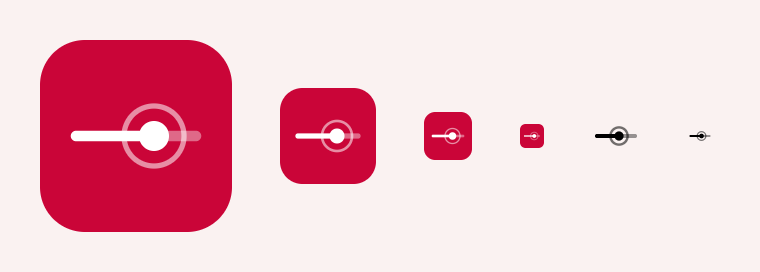
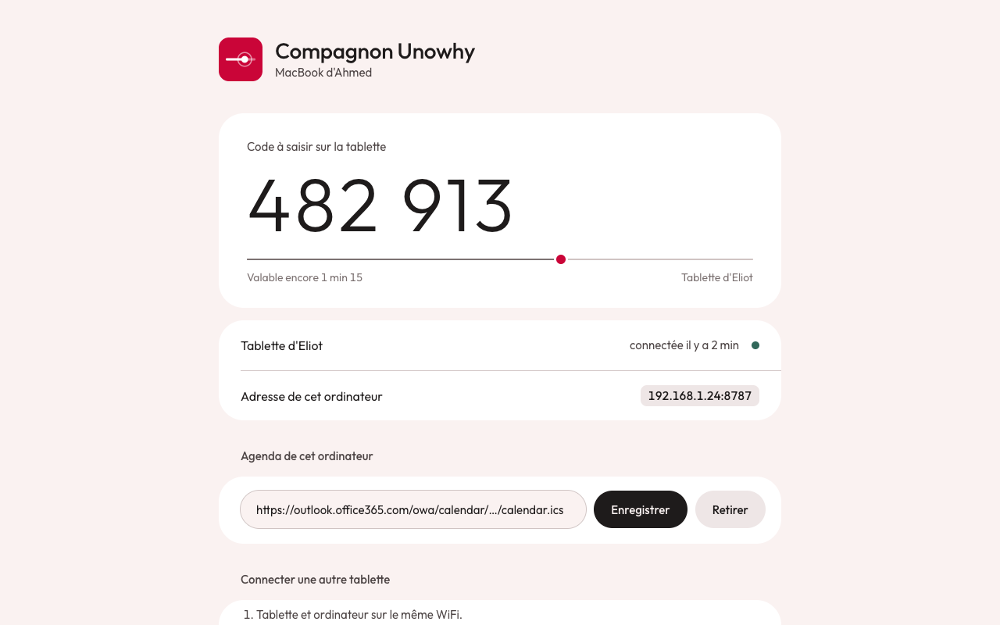
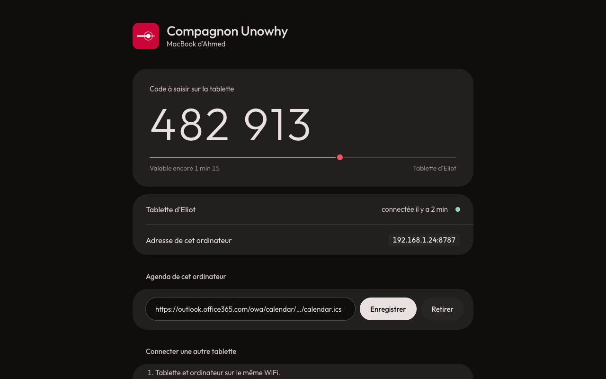

# Cadran : direction artistique du compagnon

Le temps, posé sur le bureau.

La tablette vit à côté de l'ordinateur toute la journée. Presque tout ce qu'elle affiche dépend de
l'heure : agenda, rappels, Focus, eau, passage en nuit. Cadran en fait le sujet de l'interface. Le
rouge Unowhy signale le présent, le reste s'efface.

| Accueil, jour | Accueil, nuit |
|---|---|
|  |  |

| Menu ouvert | Écran Focus |
|---|---|
|  |  |

Mouvement : [`demo.mp4`](demo.mp4) (46 s, légendé, un doigt simulé montre les gestes). Prototype
interactif : [`accueil.html`](accueil.html) (`?demo&legende` rejoue la démonstration,
`?theme=nuit`, `?menu`, `?fige`). Tout réagit : poignée à glisser, menu, tuiles, touches, cases,
verres d'eau, rendez-vous de la ligne du jour, pause du Focus.

Pour la suite (activités en direct, calme, son, techniques) : [`plus-loin.md`](plus-loin.md).

## Les six principes

1. **Une seule couleur vivante.** Le rouge cardinal d'Unowhy (`#CA0538`) veut dire « maintenant » :
   le point sur la ligne du jour, la prochaine réunion, le temps qui reste au Focus, un appel en
   cours. Rien d'autre n'est rouge. Comme la trotteuse de l'horloge des gares suisses.
2. **La ligne du jour.** De 8 h à 20 h, une ligne porte les événements. Le passé s'efface, le présent
   est un point rouge, la suite reste lisible. C'est la signature de l'Accueil, de l'icône et du
   minuteur d'appairage sur la page web.
3. **Le battement de la minute.** Une fois par minute, tout ce qui dépend de l'heure avance d'un
   seul geste : les chiffres qui changent basculent, le compte à rebours suit, le point avance et
   émet une onde. Entre deux battements, rien ne bouge.
4. **Le contenu donne la couleur.** L'interface reste en gris chaud. Les couleurs viennent des
   vraies icônes d'applis (déjà fournies par `GET /windows/icon`), de la météo, du vert Unowhy pour
   ce qui est fait. Plus de pastille colorée dans les titres.
5. **Rien n'apparaît sans besoin.** Le menu est caché : il vient quand on glisse depuis le bord
   gauche ou qu'on touche la poignée, et repart seul. Le WiFi et la batterie ne s'affichent que
   dans le menu (ou en cas de problème, comme le bandeau batterie faible). Sans toucher, l'écran
   se repose : seules l'heure et la ligne du jour restent.
6. **Le jour, la nuit.** Papier le jour, graphite la nuit. La bascule suit le vrai coucher du
   soleil (Open-Meteo le donne déjà pour la météo), en fondu de 1,6 s.

## Bâtie sur de vrais design systems

| Fondation | Source | Ce qu'on prend |
|---|---|---|
| Charte Unowhy | `unowhy.com` (variables CSS du thème) | rouge cardinal `#CA0538`, vert `#2A6154`, blanc chaud `#FAF7F8`, police **Outfit** |
| Material Design 3 : couleur | `@material/material-color-utilities` 0.4.0 | palettes tonales HCT générées depuis le rouge Unowhy, rôles `surface…`, tons de la spec 2026 |
| Material Design 3 : composants | rail de navigation étendu modal (M3 Expressive), voile, calque d'état (appui 10 %), fondu enchaîné, échelle de formes | menu, changement d'écran, retours d'appui, rayons |
| Material Design 3 : mouvement | ressorts `MotionScheme.standard` (spatial / effects) | toutes les animations, valeurs exactes ci-dessous |
| Material Symbols Rounded | google/material-design-icons, Apache 2.0 | toutes les icônes d'interface |
| Apple HIG | WWDC23 « Animate with springs », WWDC25 session 356, HIG Accessibilité | coins concentriques, contenu d'abord, cibles de 44 pt au moins |

Valeurs officielles et liens : [`../specs-ds.md`](../specs-ds.md).

## Couleur

Neutres = palette tonale M3 à la teinte du rouge Unowhy (16,2°) et chroma 2 : un gris chaud qui
rappelle le blanc de la marque sans tirer vers le rose. Tous les rôles sont des tons M3, aucun hex
n'est choisi à l'œil. Valeurs reproductibles avec la skill `direction-artistique` :
`palette.sh '#CA0538' --ok '#2A6154'`.

| Rôle (attribut actuel) | Rôle M3 | Jour | Nuit |
|---|---|---|---|
| fond (`c_bg`) | surfaceContainerLow / surface | `#FAF2F1` (T96) | `#100D0D` (T4) |
| tuile (`c_surface`) | surfaceContainerLowest / surfaceContainerHigh | `#FFFFFF` (T100) | `#221F1F` (T12) |
| relief (`c_surface_raised`) | surfaceContainerHigh / Highest | `#EEE6E6` (T92) | `#282525` (T15) |
| texte (`c_text`) | onSurface | `#1E1B1B` (T10) | `#E9E1E0` (T90) |
| texte secondaire (`c_text_dim`) | onSurfaceVariant | `#4D4545` | `#D0C4C3` |
| texte tertiaire (`c_text_faint`) | outline, ajusté à 4,5:1 sur fond, tuile et relief | `#6F6666` | `#998E8E` |
| graphique (`c_graphic`) | outline, ajusté à 3:1 : graduations éteintes, piste de la ligne du jour, poignée | `#8C8181` | `#776D6D` |
| filet (`c_stroke`) | outlineVariant | `#D0C4C3` | `#4D4545` |
| maintenant (`c_accent`) | rouge Unowhy, palette tonale | `#CA0538` | `#FF5165` (T60) |
| fond du maintenant (`c_accent_soft`) | T90 / T20 | `#FFDADA` | `#680018` |
| fait (`c_ok`) | vert Unowhy, palette tonale | `#31685A` (T40) | `#9AD2C1` (T80) |

Contrastes (ratio M3) : rouge sur fond 5,3 en jour et 5,4 en nuit, texte tertiaire au moins 4,5 sur toutes les surfaces, graphique au moins 3, texte secondaire sur tuile 9,3
et 11,4, vert sur tuile 6,4 et 9,6. Tout passe le seuil de 4,5.

Les huit teintes `c_hue_*` disparaissent. Les tâches, l'agenda et les touches se distinguent par
leur contenu et leur place, plus par une couleur.

## Typographie

Une seule famille : **Outfit**, la police d'Unowhy. Elle a les chiffres tabulaires (`tnum`,
vérifié dans le fichier) : les chiffres ne sautent pas quand l'heure change.

| Usage | Taille / interligne | Graisse | Base M3 |
|---|---|---|---|
| Horloge | 184 / 176 px, approche −3,5 % | 300 | au-delà de Display Large, comme StandBy |
| Valeurs (météo, prochain rendez-vous, Focus) | 44 à 52 / 48 à 56 | 300 | Display Small agrandi |
| Date | 26 / 32 | 400 | Headline Small |
| Titre d'élément | 18 / 24 | 500 | Title Medium |
| Texte | 16 / 20 | 400 | Body Large |
| En-tête de tuile, secondaire | 14 à 15 / 20 | 400 à 500 | Label Large |
| Heures de la ligne du jour | 12 / 16 | 500 | Label Medium |

Les grands chiffres sont fins, le texte courant reste en 400 : la hiérarchie vient de la taille, pas
de la graisse. Pas de capitales espacées, pas de titre en couleur.

Sur Android : instances statiques 300, 400, 500 réduites au latin dans `res/font/` (le fichier
variable fait 111 Ko ; les axes ne sont pilotables qu'à partir de l'API 26), et
`fontFeatureSettings="tnum"` sur les chiffres.

## Formes et espace

- Grille de 8 : marges 32, gouttières 16, marge intérieure des tuiles 24.
- Tuile : rayon 32. Éléments intérieurs collés au bord : 32 − 24 = **8** (coins concentriques, HIG).
- Touches d'applis : 60 px, rayon 22, coin continu (`corner-shape: squircle` dans le prototype,
  `Path` mis en cache sur Android).
- Boutons et puces : pilule (rayon = moitié de la hauteur), hauteur 44 au moins.
- Aucune ombre, aucun flou, aucun dégradé : la profondeur vient des tons (T96 → T100 le jour,
  T4 → T12 la nuit).

## Mouvement

Ressorts M3 `MotionScheme.standard`. Le schéma « expressive » rebondit davantage ; on le garde pour
plus tard si la tablette le permet.

| Jeton | Amortissement | Raideur | Usage |
|---|---|---|---|
| spatial fast | 0,9 | 1400 | appui, sortie d'un chiffre, barre de tâche faite |
| spatial default | 0,9 | 700 | entrée d'un chiffre, point « maintenant », tâche qui descend, tuiles qui arrivent |
| spatial slow | 0,9 | 300 | la ligne du jour qui se dessine à l'arrivée |
| effects fast | 1 | 3800 | disparition d'un chiffre |
| effects default | 1 | 1600 | apparitions, coche qui se trace |
| effects slow | 1 | 800 | onde du battement |

| Moment | Ce qui bouge | Ce qui ne bouge pas | Coût estimé sur le MT8167 |
|---|---|---|---|
| Battement de la minute | 1 à 4 chiffres (translation Y + alpha, cadre qui coupe), compte à rebours, point + onde | tout le reste | 6 à 10 vues ~400 ms, une fois par minute : négligeable |
| Arrivée de l'Accueil | trait du passé (échelle X), événements (alpha), onde, tuiles décalées de 50 ms (Y + alpha) | horloge (simple fondu) | ~700 ms, 12 vues ; déjà le cas avec `Look.enter` |
| Menu qui suit le doigt | panneau (translation X collée au doigt), voile (alpha) ; au lâcher, ressort qui part de la vitesse du doigt | contenu dessous | 2 vues, une par image pendant le geste |
| Ouverture du menu | panneau (spatial default), voile, 7 entrées décalées de 28 ms (X + alpha) | — | 9 vues, ~450 ms |
| Changer d'écran | indicateur qui glisse (Y), puis fondu enchaîné M3 : sortie en alpha, entrée en alpha + échelle 0,92 → 1 | — | 2 écrans en calque matériel le temps du fondu (~400 ms) |
| Appui | échelle 0,96 + calque d'état 10 % | voisins | 1 vue, 200 ms |
| Touche d'appli | appui, puis onde neutre autour de l'icône quand l'action est partie | — | 2 vues |
| Rendez-vous touché | bulle qui naît de sa barre (échelle 0,86 → 1 depuis le coin, Y, alpha), repart seule | ligne du jour | 1 vue |
| Verre d'eau | la barre se remplit par le bas (échelle Y), le compte bascule | autres verres | 2 vues |
| Tâche faite | coche qui rebondit (échelle 0,7 → 1) et se trace (`AnimatedVectorDrawable`), barre (échelle X), puis descente des lignes (translation Y) | tuile | 5 vues, 1 s |
| Pause du Focus | les graduations s'éteignent une à une (18 ms d'écart), l'icône pause se change en lecture (échelle + alpha) ; à la reprise, elles se rallument | chrono | 25 traits redessinés en cascade (~450 ms) : à mesurer, sinon redessin en un seul passage |
| Repos | tuiles qui s'effacent et descendent (ordre inverse) ; un toucher les fait revenir | heure, ligne du jour | 4 vues, une fois |
| Nuit | fondu croisé plein écran 1,6 s (capture de l'écran en image, `recreate()`, l'image s'efface) | — | une image 1280 × 800 (4 Mo) une fois par jour |

Sortie plus rapide que l'entrée partout (spatial fast pour fermer, spatial default pour ouvrir).
Chaque ressort est interruptible : il repart de la position et de la vitesse courantes, jamais
d'un saut.

Règles :

- Jamais de boucle. Seul le chrono du Focus change chaque seconde, en texte (chiffres tabulaires,
  largeur fixe : pas de relayout).
- Jamais de largeur ou de hauteur animée : translation, échelle, alpha seulement.
- Pas d'ombre, de flou ni d'`elevation` animés (coûteux sur le PowerVR GE8300, `RenderEffect`
  absent en API 29).
- Animations coupées si l'échelle d'animation Android vaut 0, comme `prefers-reduced-motion` dans
  le prototype.

Sur Android : `SpringAnimation` de `androidx.dynamicanimation` 1.1.0 avec
`SpringForce(stiffness, dampingRatio)` aux valeurs ci-dessus (mêmes équations que le prototype).
Il tourne sur le fil principal, pas sur le RenderThread : à garder pour des groupes de quelques
vues. Les fondus simples restent en `ViewPropertyAnimator`. ⚠️ Les coûts ci-dessus sont estimés.
Ils seront mesurés avec `dumpsys gfxinfo` sur l'écran de preuve.

## Marque

- Icône : la ligne du jour, le présent et son onde, en blanc sur rouge cardinal ([`icone.svg`](icone.svg)),
  version monochrome pour les notifications et l'extension de navigateur ([`icone-mono.svg`](icone-mono.svg)).
  ⚠️ En petit, elle peut rappeler un curseur de réglage. À valider à 16 px dans la barre du navigateur.
- Pages web (page locale, `/camera`, retour OAuth) : mêmes tokens, même police, mêmes formes. Le
  code d'appairage reprend la ligne du jour : le point rouge avance pendant ses 2 minutes de validité.

| Page locale, jour | Page locale, nuit |
|---|---|
|  |  |

- Ton des textes : phrases courtes au présent, tutoiement comme aujourd'hui, l'heure avant le
  libellé (« 17:00 Point Eliot »), jamais de point d'exclamation.

## Ce que Cadran refuse

Le look « généré » : cartes bleu nuit, néon, dégradés violet → turquoise, pastille colorée devant
chaque titre, capitales espacées, emoji, polices Space Grotesk / Inter par défaut, trame de points
façon Nothing.

## Passage dans l'appli (après validation)

1. `palettes.xml` : une palette Jour, une palette Nuit, valeurs du tableau Couleur. Les attributs
   `?attr/c_…` ne changent pas de nom.
2. `res/font/` : Outfit 300, 400, 500, puis styles de texte dans `themes.xml`.
3. `ui/Look.kt` : jetons de ressort, appui, battement de la minute (un seul `Handler` calé sur la
   minute pleine).
4. Menu : la barre latérale de `MainActivity` devient un panneau caché, ouvert par un geste depuis
   le bord ou par la poignée. `TabletStatusView` passe dans son pied.
5. Écran par écran, en commençant par une carte de l'Accueil (écran de preuve), captures avant/après
   et mesure `gfxinfo` sur `companion_api29`, puis la vraie tablette.
