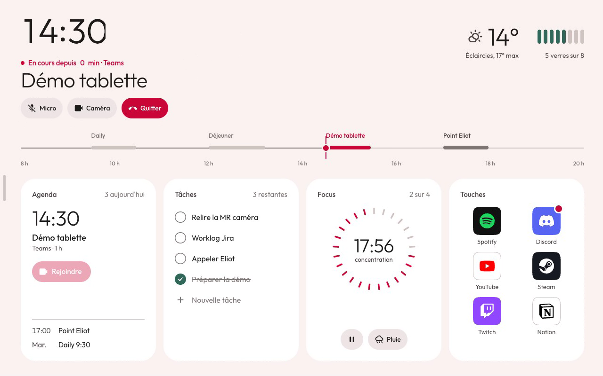
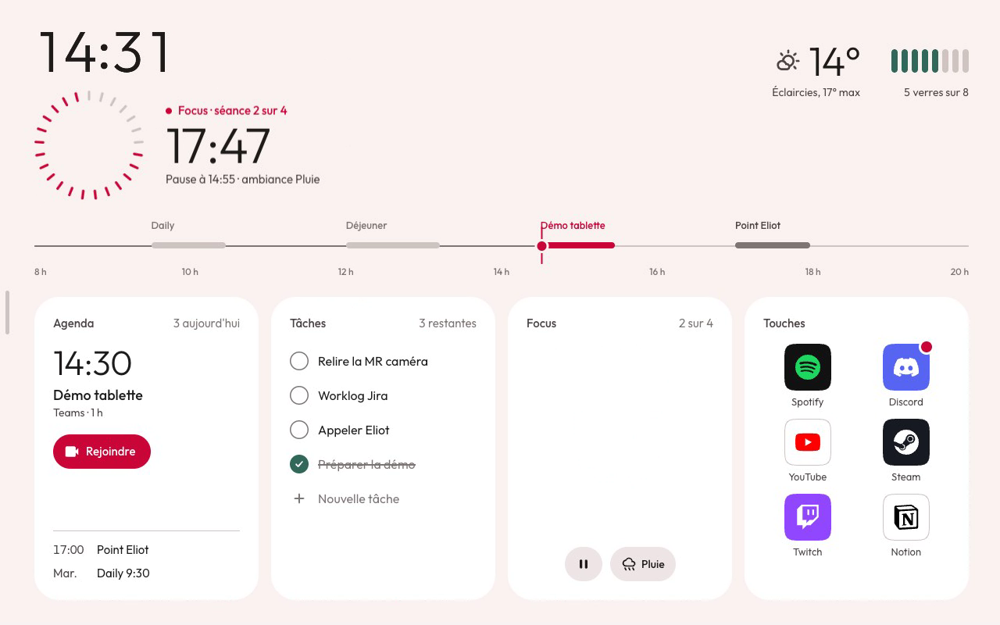

# Cadran : aller plus loin

Recherche du 27/10/2026. Sources détaillées : [`_scout-references.md`](_scout-references.md)
(usages, Apple, Google, calm technology, son et haptique) et [`_scout-android.md`](_scout-android.md)
(techniques et coûts sur la tablette).

## Ce qu'on retient

1. **Le présent prend la place** (Live Activities d'Apple). Quand une réunion commence ou qu'un Focus
   tourne, l'heure se replie dans le coin et ce qui se passe maintenant prend le haut de l'écran.
   C'est la suite logique du rouge = maintenant. **Prototypé**, voir ci-dessous.
2. **Le calme d'abord** (calm technology, modes ambiants d'Apple et de Wear OS). Le repos garde la
   même mise en page, une mise à jour par minute, aucune animation ; la nuit tardive passe au rouge
   seul, comme StandBy.
3. **Un événement = une image, un son, un clic.** Son et haptique rares, courts, synchronisés avec
   le mouvement, coupés la nuit.
4. **Des transitions qui tournent hors du fil principal** quand c'est possible (révélation
   circulaire pour la nuit, vecteurs animés pour les icônes), et une mesure de chaque mouvement sur
   la vraie tablette avec JankStats.

## 1. Le présent prend la place (prototypé)

| Réunion en cours | Focus en cours |
|---|---|
|  |  |

Vidéo : [`en-direct.mp4`](en-direct.mp4) (25 s). Prototype : [`accueil.html?direct&legende`](accueil.html).

- **Réunion** : à « Rejoindre », l'horloge se replie (échelle 0,4 depuis son coin), la date
  s'efface, la réunion entre en décalé : « En cours depuis 0 min », titre, Micro / Caméra / Quitter.
  Le battement continue de compter les minutes. « Quitter » rend sa place à l'heure, et
  « Ensuite » passe au rendez-vous suivant.
- **Focus** : toucher le cadran de la tuile le fait voler jusqu'en haut (container transform fait
  maison : une seule transformation calculée au départ). Le toucher à nouveau le renvoie dans sa
  tuile.
- Règles reprises de la HIG Live Activities : fin nette dès que l'activité s'arrête, durée bornée,
  mise à jour seulement quand le contenu change, éléments animés vers leur nouvelle place plutôt
  que retirés puis remis.
- À étendre : appel Discord entrant (déjà détecté par `calls.ts`), musique en cours (page Média),
  rappel parlé. Une seule activité à la fois ; la plus récente gagne.

## 2. Le calme d'abord

| Idée | Source | Pour Cadran |
|---|---|---|
| Garder la même mise en page en repos | HIG Always On ; Wear OS Always-on | Le repos actuel fait disparaître les tuiles. Mieux : les **atténuer** (texte en `outline`, aplats retirés) sans les déplacer. Un composant devient indisponible, il ne disparaît pas. |
| Le mouvement se pose, il ne s'arrête pas net | HIG Always On | L'entrée en repos dure moins de 2 s, ressort lent, puis plus rien ne bouge. |
| Zéro animation en repos, une mise à jour par minute | Wear OS Always-on | Confirme le battement : en repos, il se réduit au changement des chiffres, sans onde. |
| Peu de pixels allumés | Wear OS (15 % au plus) | Nuit tardive : fond noir, contours plutôt qu'aplats. |
| Nuit rouge | StandBy (Night Mode) | Après 23 h et sans toucher : heure et ligne en rouge sombre seul, luminosité au plus bas. Le rouge Unowhy s'y prête. |
| La technologie marche même en panne | Calm technology (Amber Case) | Ordinateur injoignable : heure, ligne du jour, Eau et Focus restent, calculés sur la tablette. |
| Le minimum utile | Calm technology | En repos, rien d'autre que l'heure, la ligne et l'activité en cours. |
| Texte qui grossit quand on s'éloigne | Nest Hub (présence par ultrasons, ~1,2 m) | ⚠️ Piste lointaine : demande un capteur de présence. La tablette n'en a pas de vérifié. À relever par `adb shell dumpsys sensorservice` quand elle sera branchée. |

## 3. Son et haptique

| Règle | Source | Pour Cadran |
|---|---|---|
| Moins c'est mieux ; entre un retour « buzzy » et rien, choisir rien | Android, Haptics design principles | Pas de vibration sur le battement ni sur les appuis ordinaires. |
| Clic net de 10 à 20 ms | Android, Haptics design principles | Seulement pour une action confirmée (touche d'appli partie, tâche faite, fin de Focus). |
| Image, son et clic synchronisés | Android, Haptics design principles | L'onde, le son et le clic partent au même instant. |
| Sons en catégorie « ambient », coupés en silencieux | Apple HIG, Playing audio | Sons d'interface courts, discrets, jamais la nuit, coupés si le son de la tablette est muet. |
| Haptique optionnelle et rare | Apple HIG, Playing haptics | Réglage « Retours » dans Réglages. ⚠️ La tablette a-t-elle un vibreur ? À vérifier. |

Une palette sonore Cadran tiendrait en quatre sons générés (comme `audio/Crunch`) : action partie,
tâche faite, début et fin de Focus. Même timbre, hauteurs différentes.

## 4. Techniques et coûts sur la tablette

| Technique | Ce qu'elle apporte | Thread | Coût, poids | Pour Cadran |
|---|---|---|---|---|
| `ViewAnimationUtils.createCircularReveal` | révélation en cercle (`RevealAnimator`, dérivé de `RenderNodeAnimator`) | RenderThread | aucune dépendance ; usage unique, pas de pause | passage jour → nuit qui part du soleil de la météo, ou du point « maintenant », au lieu d'un fondu plein écran |
| `AnimatedVectorDrawable` | icônes animées, tracés (`trimPath`), morphing de formes | RenderThread dès l'API 25 | aucune dépendance ; morphing seulement entre tracés aux mêmes commandes | pause ↔ lecture, micro ↔ coupé, coche, poignée du menu qui devient flèche pendant le geste |
| `ViewPropertyAnimator` | alpha, translation, échelle | calcul sur le fil principal, rendu par le RenderNode | aucune dépendance | défaut pour tout le reste, comme aujourd'hui dans `Look.kt` |
| `SpringAnimation` (dynamicanimation 1.1.0) | ressorts M3, interruptibles | fil principal | petite dépendance | appuis, menu qui suit le doigt, container transform maison |
| `MaterialContainerTransform` | transition d'une tuile vers un écran | fil principal | ajoute Material Components ; ombres coûteuses avant l'API 28 | non : la version maison du prototype (une transformation calculée une fois) suffit |
| `androidx.graphics:graphics-shapes` 1.1.0 | formes M3 Expressive et morphing (`Morph.toPath`) | dessin sur `Canvas` | ⚠️ minSdk non trouvé | piste pour l'indicateur du menu ou la pastille « maintenant » ; à mesurer |
| Lottie 6.7.1, Rive 11.15.0 | animations de designer | Lottie repasse en rendu logiciel jusqu'à l'API 25 | poids et coût non mesurés | non : AVD couvre nos besoins sans dépendance |
| `JankStats` 1.0.0 (androidx.metrics) | images en retard mesurées dans l'appli | — | compatible minSdk 24 | journal des images saccadées par écran, en debug |
| Baseline Profile + ProfileInstaller | démarrage et premières animations plus rapides | — | gain sourcé +15 % (AGP 8.2) | à tenter : l'APK est installé hors Play Store, ProfileInstaller s'en charge |

À vérifier sur la vraie tablette : capteur de lumière (bascule jour/nuit sans réseau), vibreur, latence de `SoundPool`.

## Priorités

| Idée | Apport | Effort | Coût sur la tablette | Risque | Priorité |
|---|---|---|---|---|---|
| En direct (réunion, Focus) | fort : l'écran répond à ce qui se passe | moyen | faible (transformations) | faible | 1 |
| Repos qui garde la mise en page | moyen : plus calme, moins de saut | faible | nul | faible | 1 |
| Marche hors ordinateur | fort pour la confiance | moyen | nul | faible | 2 |
| Nuit rouge tardive | moyen, très identitaire | faible | nul | faible | 2 |
| Nuit par révélation circulaire | moyen, très visible | faible | nul (RenderThread) | faible | 2 |
| Icônes animées (AVD) | moyen : finition | moyen | nul (RenderThread) | faible | 2 |
| Palette sonore + clic | moyen | faible | faible | dépend du matériel | 3 |
| Texte qui grossit à distance | fort mais incertain | élevé | moyen | capteur absent | plus tard |
