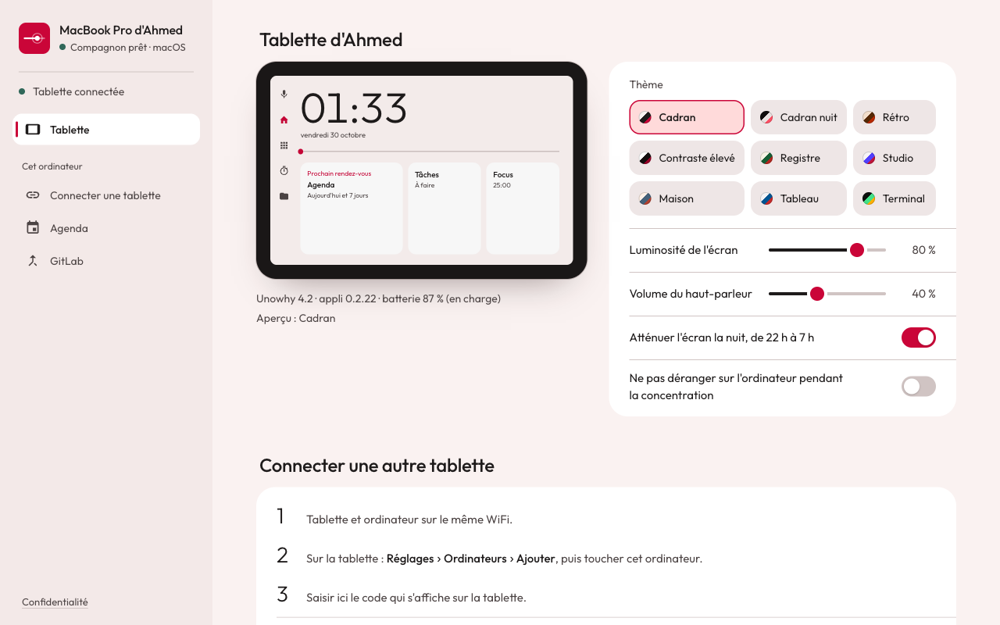
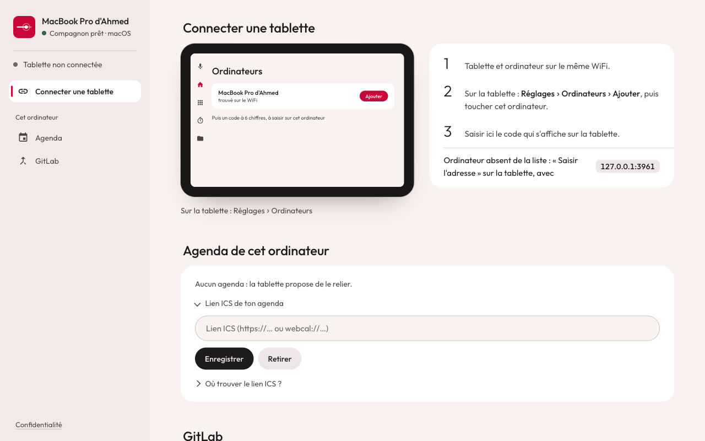
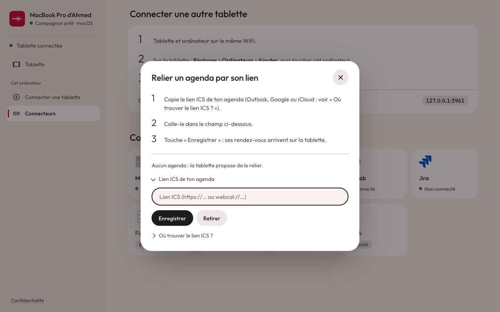

# Page du compagnon : guide de design pour y ajouter des sections

Pour qui ajoute une section à la page locale (`GET /`, `backend/src/local-page.ts`), en premier lieu la
configuration des profils, touches, applis et barres de la tablette depuis l'ordinateur.

Sources : [`DESIGN.md`](../../DESIGN.md) (tokens, typo, composants) et [`PRODUCT.md`](../../PRODUCT.md)
(public, principes). Ce guide dit comment s'y brancher sans casser la page.

| Tablette reliée               | Sans tablette                      | Connecteur (modale)                    |
| ----------------------------- | ---------------------------------- | -------------------------------------- |
|  |  |  |

Autres captures : [`connecteurs.png`](page-locale/connecteurs.png), [`mobile.png`](page-locale/mobile.png) (390 px).

## La page

- **Barre de gauche** (272 px, fond `--rail`) : logo, nom de l'ordinateur, état du compagnon et de la
  tablette, puis une entrée par section. Un trait rouge glisse sur la section lue, comme la barre de la
  tablette. Sous 820 px, la barre passe en bande horizontale en haut.
- **Contenu** : toutes les sections l'une sous l'autre (pas d'onglets), largeur 1080 px au plus.
- **Ordre** : Tablette, puis vos sections, puis le groupe « Cet ordinateur » (Connecter une tablette,
  Connecteurs, Cette appli). Sans tablette, « Connecter une tablette » passe en tête.

## Brancher une section

Tout votre code dans un module à part, `backend/src/local-config.ts`, qui exporte trois chaînes. Dans
`local-page.ts`, seulement trois interpolations, sur les marqueurs :

| Marqueur dans `local-page.ts`                                       | À remplacer par  |
| ------------------------------------------------------------------- | ---------------- |
| `<!-- CONFIG_HTML -->` (juste après la section `#tabletcard`)       | `${CONFIG_HTML}` |
| `/* CONFIG_CSS */` (fin du `<style>`)                               | `${CONFIG_CSS}`  |
| `/* CONFIG_JS */` (fin du `<script>`, avant le premier `refresh()`) | `${CONFIG_JS}`   |

Chaque section :

```html
<section id="pf-profils" data-title="Profils" data-icon="grid">
  <div class="sechead">
    <h2>Profils de la tablette</h2>
    <span class="dim">Une phrase qui dit à quoi ça sert.</span>
  </div>
  …
</section>
```

- `data-title` : nom dans la barre, court (un ou deux mots).
- `data-icon` : `tablet`, `grid`, `keys`, `plug`, `apps`, `bars`, `link`, `add`, `calendar`, `merge`, `power`.
  Une icône manque : ajouter son tracé Material à `ICONS` dans `local-page.ts`, pas d'emoji ni de caractère.
- `data-group` : ne pas le mettre (« Cet ordinateur » est réservé aux réglages de l'ordinateur).
- `hidden` sur la section : elle sort de la barre au rafraîchissement suivant (toutes les 1,5 s, `buildRail`).
  Typiquement : section masquée tant qu'aucune tablette n'est reliée.

## Composants à réutiliser

Votre branche s'empile sur `feat/page-compagnon-visuel` : réutilisez ses classes plutôt que d'en recréer.
Préfixez `pf-` seulement ce qui est propre à vos sections. Le même rôle garde le même style partout.

**Carte et liste de réglages** (une ligne par réglage, filet fin entre deux) :

```html
<div class="card group">
  <div class="row">
    <label for="pf-x">Libellé du réglage</label
    ><input type="checkbox" id="pf-x" />
  </div>
  <div class="row">
    <span class="grow">Texte et action</span
    ><button class="ghost">Modifier</button>
  </div>
  <div class="dim note">Message de retour (vide = masqué).</div>
</div>
```

**Boutons** (pilules de 40 px) : `<button>` principal (encre pleine), `class="ghost"` secondaire,
`class="danger"` pour supprimer. Un seul bouton principal visible par bloc.

**Contrôles** : `input[type=checkbox]` est un interrupteur, `input[type=range]` un curseur (appeler
`paintRange(range)` après avoir changé sa valeur, pour la partie remplie), `input` texte en pilule.

**Choix parmi quelques valeurs** (comme les thèmes) : boutons en grille avec `aria-pressed="true|false"`.
Le style sélectionné (fond `--now-soft`, anneau `--now`) vient de `.themes button`. Pour un autre groupe,
reprendre ces deux règles sous une classe `pf-`.

**Grille de tuiles** (profils, touches, applis) : le motif des connecteurs, `.connectors` + `.cx`. Une tuile
= icône 32 px, nom en 500, état en 13 px avec pastille `.dot` (`on` vert, `ko` rouge). Tuile choisie :
`aria-pressed="true"`. Pas de grille de cartes identiques avec icône dans un carré coloré.

**Modale** (éditer une touche, renommer un profil) : `<dialog class="cxdialog">` ouvert par `showModal()`,
avec la même structure que celle des connecteurs. Elle se ferme par la croix, Échap ou un clic à côté :

```html
<dialog class="cxdialog" id="pf-edit" aria-labelledby="pf-edit-title">
  <div class="cxbody">
    <header class="cxhead">
      <h2 id="pf-edit-title">Modifier la touche</h2>
      <button class="close" aria-label="Fermer">…icône croix…</button>
    </header>
    …
  </div>
</dialog>
```

Fermer au clic sur le fond : `dialog.addEventListener("click", (e) => { if (e.target === dialog) dialog.close(); })`.
Une modale seulement pour une tâche qui la justifie. Un réglage simple reste dans la page.

**Étapes numérotées** (marche à suivre) : `<div class="cxsteps"><ol><li>…</li></ol></div>`, chiffres fins en Outfit 300.

**Aperçu de la tablette** : `.device > .screen`, à l'échelle 16:10, couleurs du thème par les variables
`--t-bg`, `--t-tile`, `--t-ink`, `--t-ink2`, `--t-now`, `--t-line` (table `THEMES` du script). Utile pour
montrer un profil tel qu'il sera sur la tablette. Reprendre le boîtier, ne pas en dessiner un second.

## Règles

- **Couleurs** : seulement les tokens de `web-style.ts` (`--bg`, `--tile`, `--tile-high`, `--rail`, `--ink`,
  `--ink-2`, `--ink-3`, `--line`, `--now`, `--now-soft`, `--on-now`, `--ok`, `--ok-soft`, `--ko`), jamais
  de couleur en dur (sauf les couleurs de la tablette dans un aperçu). Jour et nuit suivent le système.
- **Rouge `--now`** : la sélection, ce qui demande une action, le « maintenant ». Jamais en décoration.
- **Texte** : Outfit 400 pour le corps, 500 pour les titres et boutons, 300 pour les grands chiffres.
  `--ink-2` pour le texte secondaire (contraste 4,5:1 au moins dans les deux modes).
- **Mots** : français, tutoiement, mêmes mots que la tablette (« profil », « touche », « Deck »). États
  simples (« Connecté », « Non connecté ») : pas de jargon technique dans un état.
- **Pas de cartes dans des cartes**, pas d'étiquette en capitales au-dessus d'un titre, pas d'emoji.
- **Mouvement** : 150 à 250 ms, sortie douce (`cubic-bezier(.16, 1, .3, 1)`), sans rebond. Coupé par
  `prefers-reduced-motion` (règle globale déjà en place).
- **Sécurité** : données du serveur injectées par `textContent`, jamais `innerHTML`.
- **Accessibilité** : chaque contrôle a un libellé (`<label for>`, texte ou `aria-label`), focus visible
  (anneau `--now` global), cibles de 40 px au moins.

## Avant la MR

- Une capture de chaque section en 1280 px jour et nuit, et en 390 px.
- Un test Playwright par comportement visible dans `backend/e2e/` (ce qui s'affiche selon l'état).
- `npx playwright test`, `npm run typecheck`, `npm run format:check` dans `backend/`.
