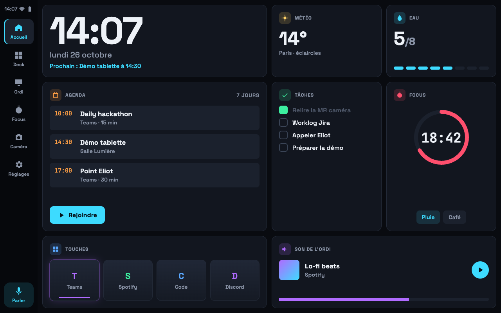
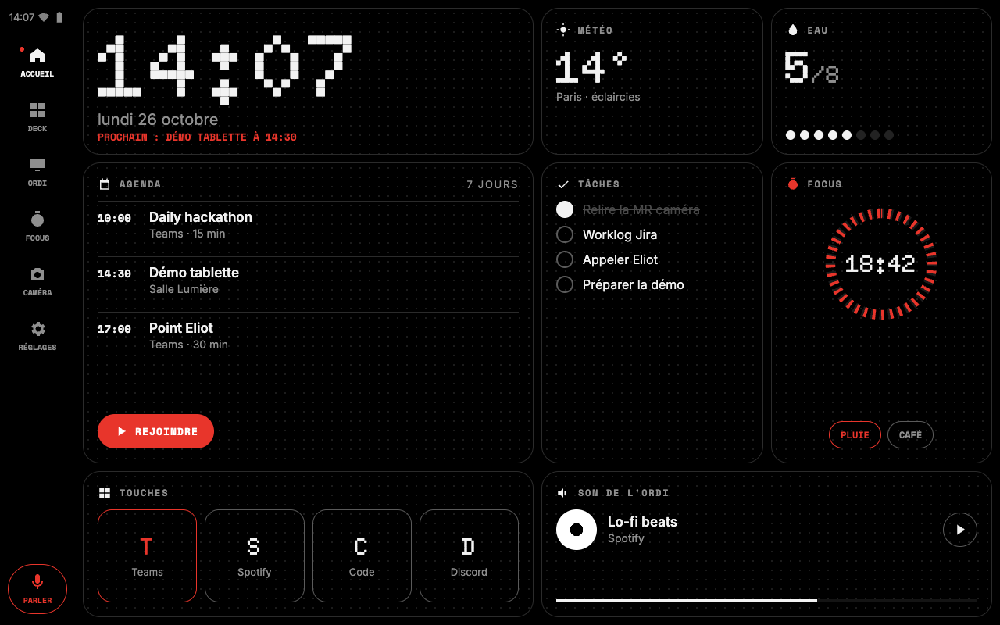
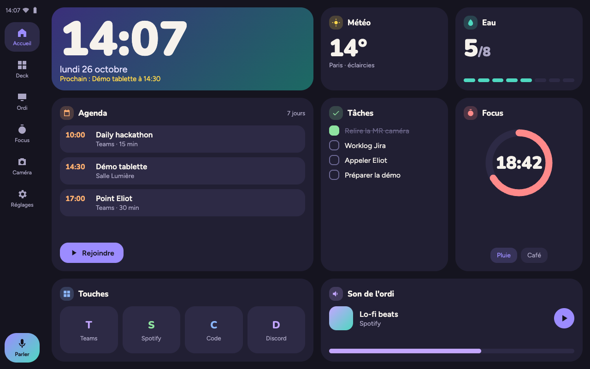

# Recherche UI/UX : outils, directions, XML ou Compose

Recherche du 26/10/2026. But : une UI de produit fini, épurée, animée sans saccade sur la tablette 4.2
(MT8167, 4 × Cortex-A35 1,3 GHz, GPU PowerVR GE8300, 2-3 Go, Android 10, 1280×800).

## Recommandation

1. **Rester en vues XML.** Compose ajoute ~800 Ko à l'APK et un démarrage plus lent sans gain prouvé
   sur ce matériel ; nos animations tiennent avec `ViewPropertyAnimator` (déjà dans `ui/Look.kt`).
2. **Choisir une direction** parmi les trois ci-dessous, puis la décliner en tokens dans
   `palettes.xml` (les attributs `?attr/c_…` existent déjà : c'est un changement de valeurs, pas d'architecture).
3. **Installer peu** : skills Android officiels de Google (mesure du jank, R8), `frontend-design`
   pour les pages web, mise à jour de ui-ux-pro-max. Liste exacte en fin de document, à valider.

## Inventaire de l'existant (déjà installé)

| Outil | État | Utile ici pour |
|---|---|---|
| ui-ux-pro-max 2.11.0 (+ design, design-system, ui-styling, brand, banner-design, slides) | activé | règles UX, palettes, polices, fichier de règles Jetpack Compose. Sortie générique sur ce sujet (propose Orbitron + vert OLED) : garde-fou, pas source de style |
| visual-design-system (skill perso) | actif | maquettes HTML rapides (pages web du backend) |
| superpowers, context-engineering | activés | méthode, pas de design |
| everything-claude-code 1.7.0 | installé, **désactivé** | `frontend-patterns`, `liquid-glass-design` (iOS) : rien de propre à Android |
| context7 | installé, **désactivé** | doc à jour de Material Components / AndroidX |
| MCP Figma (claude.ai) | connecté | si une maquette Figma est faite |
| MCP Playwright | connecté | captures des pages web du backend |
| MCP `tablette` (projet) | échec au démarrage (`backend/node_modules` absent dans ce worktree) | pilotage de la tablette |
| adb + émulateurs `companion_api29`, `companion_test_api29` | présents | captures `screencap`, mesure `gfxinfo` |

## Outils trouvés (comparatif)

Dates = dernier push GitHub lu le 26/10/2026 via l'API.

| Outil | Quoi | Usage ici | Coût | Qualité / maintenance | Risque | Verdict |
|---|---|---|---|---|---|---|
| [android/skills](https://github.com/android/skills) (Google, Apache-2.0) | ~35 skills officiels Android | `android-profiler` (traces Perfetto, jank, démarrage), `r8-analyzer`, `edge-to-edge`, `agp-9-upgrade`, `migrate-xml-views-to-jetpack-compose` si un jour Compose | descriptions chargées en contexte (~35 lignes) | 9,8k ★, push 26/10/2026, skills datés 23/10/2026 | faible (markdown, Google) | **installer** |
| [frontend-design](https://github.com/anthropics/claude-plugins-official/tree/main/plugins/frontend-design) (Anthropic) | skill de direction esthétique web (~1 500 mots) | page locale, `/camera`, retour OAuth, page de l'installeur | 1 skill | marketplace officiel, push 23/10/2026 | nul (markdown) | **installer** |
| [ui-ux-pro-max](https://github.com/nextlevelbuilder/ui-ux-pro-max-skill) 2.15.0 | mise à jour de l'existant | idem existant | aucun | 141k ★, release 13/08/2026, push 26/10/2026 | scripts Python locaux, déjà acceptés | **mettre à jour** |
| context7 (officiel) | doc à jour par MCP | API Material Components, dynamicanimation | 1 MCP distant | officiel | faible | **réactiver** |
| [material-3-skill](https://github.com/hamen/material-3-skill) | Material 3 / Expressive | Compose seulement | 1 skill | 1,5k ★, push 15/07/2026 | dossier `bin/` non inspecté | non (XML) |
| [compose-skill](https://github.com/aldefy/compose-skill) | expert Compose | Compose seulement | 1 skill | 597 ★, push 23/07/2026 | faible | non (XML) |
| [mobile-mcp](https://github.com/mobile-next/mobile-mcp) | MCP tap/swipe/capture Android et iOS | pilotage de l'émulateur | `npx` à chaque session | 10k ★, push 26/10/2026 | exécute du code npm (épingler la version) | non : adb + `screencap` suffisent, MCP `tablette` du projet |
| [android-mcp](https://github.com/CursorTouch/android-mcp) | alternative Python | idem | `uv` + Python 3.13 | 906 ★, push 25/10/2026 | moyen | non |
| kotlin-lsp (officiel) | serveur de langage Kotlin | navigation dans le code | binaire LSP | officiel | faible | hors sujet UI, optionnel |
| superdesign (officiel, tiers) | canevas de design en ligne | maquettes | compte externe | — | envoie le code au service | non |

Doc d'installation : [plugins](https://code.claude.com/docs/en/plugins/install.md) (portées `user` → `~/.claude/settings.json`, `project` → `.claude/settings.json` versionné, `local` → `.claude/settings.local.json`) et [sécurité des plugins](https://code.claude.com/docs/en/plugins/security.md).

## Trois directions artistiques

Même contenu dans les trois maquettes (Accueil 1280×800, grille 4 × 4 réelle : horloge, météo, eau,
agenda, tâches, Focus, touches, son de l'ordi), pour comparer à l'identique. Sources HTML et captures
dans [`directions/`](directions/). Icônes : [`directions/icones.png`](directions/icones.png).

### A. Console

Un clavier de commande posé sur le bureau : tuiles sombres, une touche allumée, lisible à 1 m.



- **Références** : [Elgato Stream Deck +](https://www.elgato.com/us/en/p/stream-deck-plus), [Corsair Xeneon Edge](https://www.corsair.com/xeneon-edge) (widgets iCUE), [Loupedeck Live S](https://loupedeck.com/products/loupedeck-live-s/).
- **Palette** : fond `#090B10`, surface `#12161F`, relief `#1B212D`, bord `#232A38`, texte `#EEF2F8` / `#8B95A8` ; accent cyan `#3DDBFF`, second accent violet `#B06BFF` (touche active). Teintes de fonction gardées, plus saturées.
- **Typo** : [Space Grotesk](https://fonts.google.com/specimen/Space+Grotesk) (titres, chiffres), JetBrains Mono (heures). Titres de carte en petites capitales espacées.
- **Formes** : cartes rayon 14 dp, filet 1 dp ; touches = dégradé vertical + barre lumineuse en bas quand l'action est active.
- **Mouvement** : appui = échelle 0,96 en 80 ms puis retour 160 ms (décélération) ; touche active = halo **statique** (drawable), jamais de pulsation ; entrée des widgets décalée (existant). Rien ne bouge au repos sauf l'anneau Focus (redessiné 1 fois/s).
- **Coût MT8167** : faible. Halo = `GradientDrawable` précalculé, pas d'ombre ni de flou (`RenderEffect` n'existe pas en API 29).
- **Marque** : icône « 4 touches, une allumée » ; pages web en fond graphite, mêmes tokens.

### B. Signal

Objet minimal noir et blanc, une seule couleur pour ce qui demande l'attention.



- **Références** : [Nothing](https://nothing.tech) (interface Glyph, police matricielle), [Teenage Engineering OP-1](https://teenage.engineering/products/op-1).
- **Palette** : fond `#000000`, relief `#141414`, bord `#2B2B2B`, texte `#F2F2F2` / `#8F8F8F` ; accent unique rouge `#E8352B`. Pas de teintes par fonction : l'icône suffit.
- **Typo** : [Doto](https://fonts.google.com/specimen/Doto) (matrice de points) pour les grands chiffres seulement, Space Mono (étiquettes capitales), Inter (texte).
- **Formes** : cartes contour 1 dp rayon 22 dp sur trame de points, puces et boutons en pilule.
- **Mouvement** : quasi aucun. Changements d'état en fondu 120 ms linéaire, chiffres qui basculent ; alerte = clignotement en 2 pas d'alpha.
- **Coût MT8167** : le plus bas. La trame de points se fait en `BitmapDrawable` répété (une tuile 12 × 12 px).
- **Risques** : austère ; Doto illisible sous 28 sp ; la police variable pèse 457 Ko (à figer et sous-ensembler).
- **Marque** : sourire en points + point rouge ; pages web noires, très légères.

### C. Veille douce

Un compagnon chaleureux qui reste agréable à regarder toute la journée.



- **Références** : [Pixel Tablet en mode hub](https://store.google.com/product/pixel_tablet), [iPhone StandBy](https://support.apple.com/en-us/105111), [Material 3 Expressive](https://m3.material.io/blog/building-with-m3-expressive), tableaux [Home Assistant](https://www.home-assistant.io/dashboards/).
- **Palette** : fond `#15141F`, surface `#211F33`, relief `#2D2A45`, texte `#F6F2EC` / `#ABA6C4` ; accent violet `#9C8CFF`, second accent turquoise `#4FD8C0`, étincelle `#FFD84D`. Carte héros en dégradé violet → vert, repris de l'icône actuelle.
- **Typo** : [Nunito](https://fonts.google.com/specimen/Nunito) (titres, chiffres arrondis), [Figtree](https://fonts.google.com/specimen/Figtree) (texte, 63 Ko).
- **Formes** : grands rayons (28 dp cartes, 22 dp touches), pastilles carrées arrondies.
- **Mouvement** : ressorts légers (`SpringAnimation`, amortissement 0,75, raideur moyenne) sur l'appui et l'arrivée ; chiffres de l'horloge en fondu croisé 200 ms.
- **Coût MT8167** : moyen-faible. Ressort = propriétés RenderThread seulement ; ajoute `androidx.dynamicanimation` (petite lib, compatible API 24). Dégradé de la carte héros statique.
- **Marque** : garde la mascotte (bulle souriante + étincelle), plus sobre ; pages web assorties.

### Comparaison rapide

| | Console | Signal | Veille douce |
|---|---|---|---|
| Lisible de loin | ++ | ++ (chiffres) | + |
| Personnalité | outil gamer/pro | design objet | chaleureux, grand public, scolaire |
| Coût d'animation | faible | très faible | moyen-faible |
| Écart avec l'existant | thème Néon/Nuit retravaillé | rupture | thème Nuit + mascotte |
| Poids polices (sous-ensemble latin, statiques) | ~60 Ko | ~90 Ko | ~70 Ko |

## XML ou Compose

**Avis : rester en vues XML.**

- **Taille** : Sunflower (R8 complet) passe de 2 252 Ko en vues à 3 034 Ko en vues + Compose, 2 966 Ko en Compose seul ([compare-metrics](https://developer.android.com/develop/ui/compose/migrate/compare-metrics)). L'appli vise un APK léger, mis à jour en silence.
- **Démarrage** : Compose dépend des Baseline Profiles (~30 % plus rapide au premier lancement, même source). Installé par adb ou par notre `Updater`, l'APK n'est compilé qu'au dexopt en arrière-plan : les premiers lancements sur A35 seraient lents. Aucune mesure publique Compose vs vues sur ce bas de gamme n'a été trouvée.
- **Animation** : les deux passent par le RenderThread pour alpha/translation/échelle. Les ressorts existent en vues (`SpringAnimation`, et thème `motionSpring*` de Material Components 1.13.0, [Motion.md](https://raw.githubusercontent.com/material-components/material-components-android/master/docs/theming/Motion.md)). Material 3 Expressive complet (formes morphées, composants) n'existe qu'en Compose : c'est le seul vrai manque, et il est coûteux sur ce GPU.
- **Migration** : tout l'existant est en vues (Fragments, `WidgetGrid`, `ScreenMap`, `KeyEditor`). Un `ComposeView` incrémental est possible, mais paie toute la lib dès le premier écran.
- **À revoir si** un nouvel écran complexe arrive (éditeur, liste riche) et qu'une mesure sur la vraie tablette montre un démarrage acceptable.

## Animer à 60 i/s sur la tablette

| Technique | Coût | API 24 / 29 | Usage |
|---|---|---|---|
| `ViewPropertyAnimator` (alpha, translation, échelle, rotation) | faible, RenderThread | oui / oui | défaut (déjà dans `Look.kt`) |
| Calque matériel pendant l'anim (`withLayer()`) | mémoire GPU le temps de l'anim | oui / oui | groupes de vues qui bougent ensemble |
| `SpringAnimation` (androidx.dynamicanimation) | faible | oui / oui | appui, arrivée (direction C) |
| `AnimatedVectorDrawable` | RenderThread dès API 25 | oui / oui | icônes animées, avec parcimonie |
| Dégradés, 9-patch, `GradientDrawable` | très faible | oui / oui | halos, reliefs (remplace ombres et flou) |
| `elevation` / ombres | coûteux sur ce GPU | oui / oui | éviter |
| Animer largeur/hauteur, `requestLayout` par image | relayout CPU à chaque image | oui / oui | interdit |
| `TransitionManager`, `MotionLayout` | relayout, lourd | oui / oui | éviter |
| `RenderEffect` (flou, glow) | GPU | API 31+ | indisponible |

Mesure : `adb shell dumpsys gfxinfo com.unowhy.companion reset`, faire le geste, puis `dumpsys gfxinfo com.unowhy.companion` (images saccadées, 90e centile) ; [doc dumpsys](https://developer.android.com/tools/dumpsys), [rendu lent](https://developer.android.com/topic/performance/vitals/render). L'émulateur rend sur le GPU du Mac : il valide l'absence de relayout, pas les 60 i/s. Seule la vraie tablette tranche ; le skill `android-profiler` de Google lit les traces Perfetto.

## Polices sur Android

Polices variables : les axes ne sont pilotables qu'à partir d'API 26, et les fichiers sont lourds (Inter 877 Ko, Doto 457 Ko). Embarquer dans `res/font/` des instances **statiques** sous-ensemblées au latin (`pyftsubset`), 20 à 40 Ko par graisse. Pas de polices téléchargeables : elles passent par les services Google, absents en kiosque.

## Installation proposée (en attente de validation)

Rien n'est installé. Portée **projet** pour ce qui ne sert qu'ici (versionné dans `.claude/settings.json`, Eliot en profite), **utilisateur** pour le reste.

```text
# 1. Skills Android officiels (projet)
claude plugin marketplace add android/skills
claude plugin install android-skills@android-skills --scope project

# 2. Direction esthétique des pages web (projet)
claude plugin install frontend-design@claude-plugins-official --scope project

# 3. Mise à jour de l'existant (utilisateur)
claude plugin marketplace update ui-ux-pro-max-skill
claude plugin update ui-ux-pro-max@ui-ux-pro-max-skill

# 4. Doc à jour Material Components / AndroidX (projet)
claude plugin enable context7@claude-plugins-official --scope project
```

Non retenu : skills Compose (pas de Compose), mobile-mcp et android-mcp (adb suffit), superdesign (envoie le code dehors).

Après validation : installation, puis preuve sur **une** carte de l'Accueil dans la direction choisie, captures avant/après sur l'émulateur `companion_api29` et mesure `gfxinfo`.
